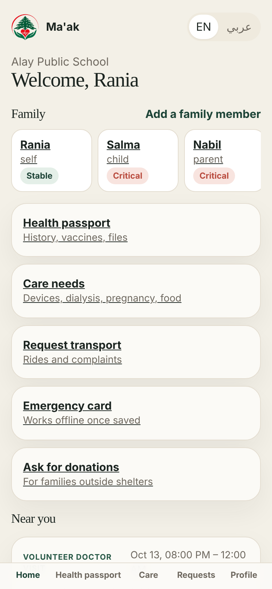
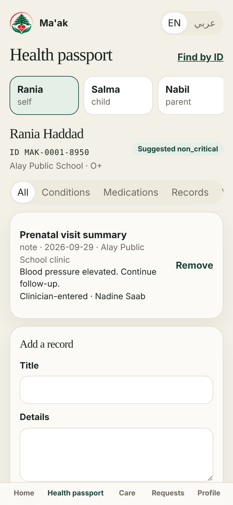
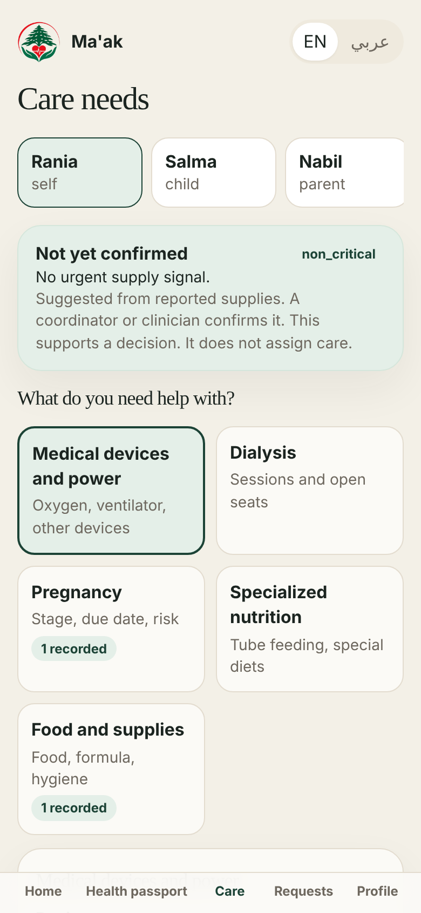
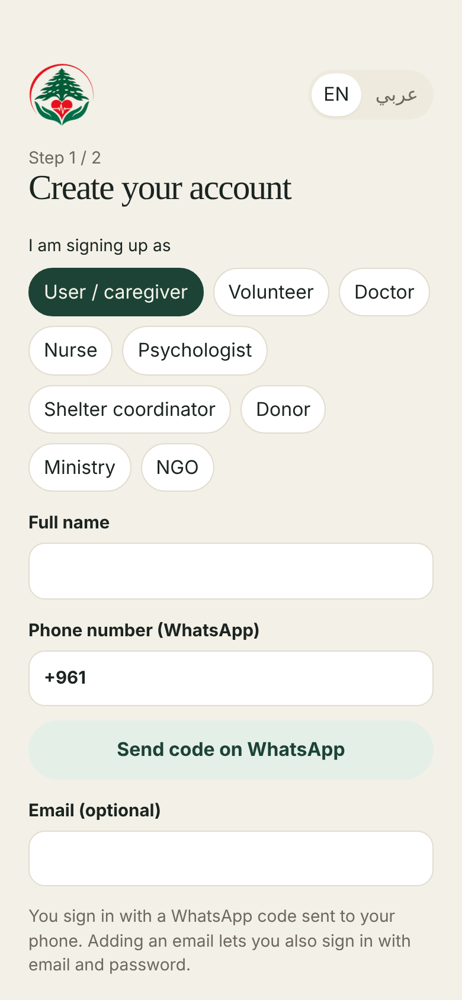
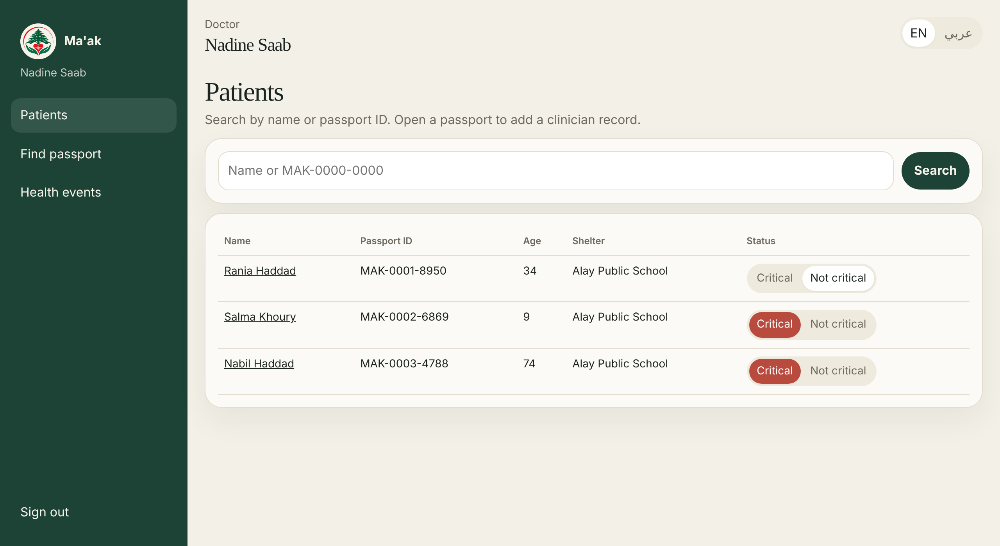
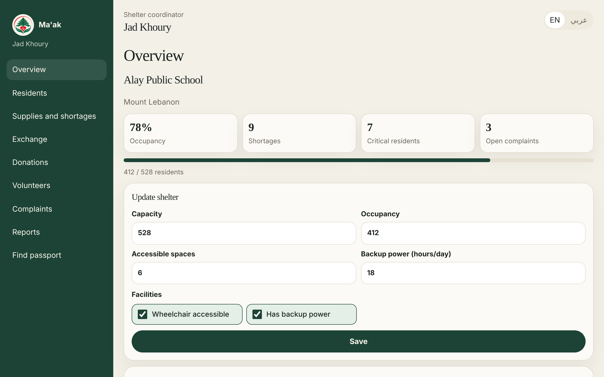
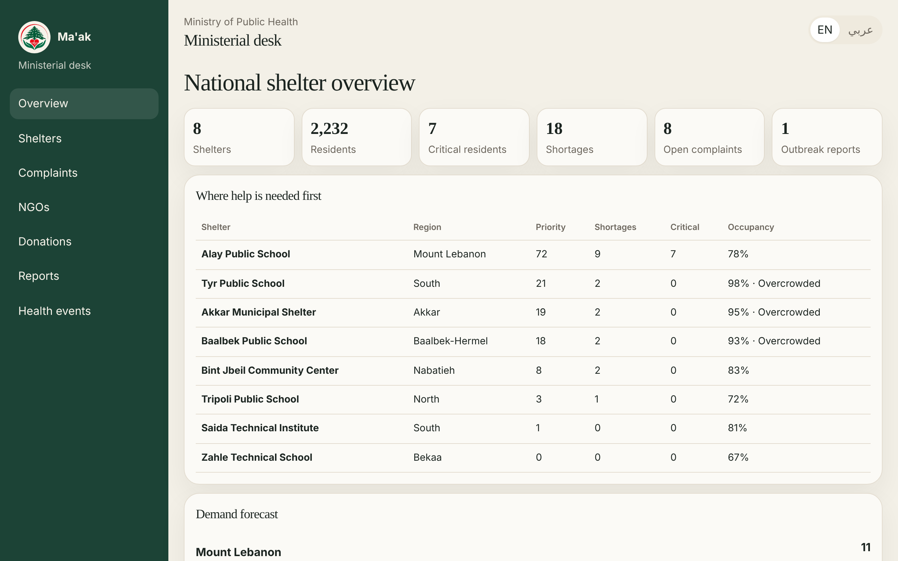

# Ma'ak — health coordination for displaced people in Lebanon

Ma'ak connects displaced families, shelter coordinators, volunteers, doctors, donors, NGOs and the
Ministry of Public Health around one thing: keeping people's health care going when they have to move.

- **Families** keep a digital health passport (with an offline emergency QR card), track critical
  needs such as oxygen, dialysis, pregnancy and nutrition, request transport, file complaints, and —
  if they live outside a shelter — ask donors for help.
- **Shelter coordinators** manage capacity, supplies and shortages, residents' criticality,
  exchanges with other shelters, donations, volunteer tasks, complaints and a monthly report.
- **Volunteers** accept delivery and companion tasks, record complaints, and report people who may
  need mental health support.
- **Doctors, nurses and psychologists** (license-verified) open passports by ID, add clinician
  records and confirm whether a patient is critical.
- **Donors** give money or supplies to verified shelter needs, medical cases or families.
- **The Ministry** sees national shelter priorities, complaints and their trends, donation
  transparency and gaps, high-risk population counts, outbreak reports and demand forecasts.
- **NGOs** offer assistance that the Ministry connects to shelters.

The app works in **English and Arabic** (right-to-left).

## Screenshots

| Family home (phone) | Health passport | Care needs |
|---|---|---|
|  |  |  |

| Sign up with a phone number | Doctor: patients |
|---|---|
|  |  |

**Shelter coordinator dashboard**



**Ministry of Public Health: national overview**



## Tech

| Part | Stack |
|---|---|
| Backend | Python 3, Flask, JWT auth |
| Database | Google Cloud **Firestore** (Firebase) |
| Verification codes | Printed in the backend terminal by default; optional **WhatsApp** (Meta Cloud API or Twilio) |
| Frontend | React 19, React Router, Vite |

Passwords and verification codes are stored only as salted hashes (scrypt), never as plain text.

## Set up Firebase (database)

1. Go to <https://console.firebase.google.com> → **Add project** (Google Analytics is not needed).
2. In the project: **Build → Firestore Database → Create database** → choose a location
   (e.g. `europe-west`) → start in **production mode**. The app talks to Firestore from the
   backend with an admin key, so no public access rules are needed.
3. **Project settings (gear icon) → Service accounts → Generate new private key.** A JSON file
   downloads. Move it to `backend/firebase-key.json`. **Never commit this file** (it is in
   `.gitignore`).

## Verification codes

Everyone signs up with a phone number confirmed by a 6-digit code. **By default no messaging
service is needed:** the code is printed in the terminal where the backend runs, like this:

```
 * WhatsApp is not configured. Verification code for +96170123456: 482913
```

Read the code from the terminal and type it in the app. This is the setup used for the
project demo. To send real WhatsApp messages instead, follow one of the optional setups below.

## Optional: send codes on WhatsApp

Codes can be sent through **Meta's WhatsApp Cloud API** (free test number) or **Twilio**.

### Option A: Meta WhatsApp Cloud API (recommended)

1. Go to <https://developers.facebook.com> and log in with Facebook → **My Apps → Create app** →
   use case **"Connect with customers through WhatsApp"** (or type *Business*) → create.
2. In the app, open **WhatsApp → API Setup**. Meta gives you a free **test phone number**.
3. Under **To**, click **Manage phone number list** and add each phone that will receive codes
   (up to 5). Each phone gets a WhatsApp message to confirm.
4. On the same page copy the **temporary access token** and the **Phone number ID**.
5. From each test phone, send any message (e.g. "hi") to the test number. WhatsApp then allows the
   app to reply with codes for 24 hours. Send another message if codes stop arriving.

In `backend/.env`:

```
META_WA_TOKEN=EAAG...your-token
META_WA_PHONE_NUMBER_ID=123456789012345
```

The temporary token expires after **24 hours**. For a token that lasts, create a **System user** in
Meta Business Settings, give it the app and the WhatsApp account, and generate a permanent token.
To message people who have not written first, create an **Authentication** message template in
WhatsApp Manager and set `META_WA_TEMPLATE` to its name.

### Option B: Twilio

Twilio's free trial is not available in every country (not in Lebanon). With a paid account, set
`TWILIO_ACCOUNT_SID`, `TWILIO_AUTH_TOKEN` and `TWILIO_WHATSAPP_FROM` in `backend/.env`; the WhatsApp
sandbox needs each phone to send its "join" phrase first.

## Configure

Copy `backend/.env.example` to `backend/.env` and fill it in:

```
MAAK_SECRET=any-long-random-text
FIREBASE_CREDENTIALS=firebase-key.json
```

Add the `META_WA_*` or `TWILIO_*` lines only if you set up WhatsApp codes.

## Run it

You need **Python 3.10+** and **Node.js 18+**.

**Backend** (terminal 1)

```bash
cd backend
pip install -r requirements.txt
python manage.py create-admin     # first time only: the first Ministry of Public Health account
python run.py                     # http://127.0.0.1:5000
```

**Frontend** (terminal 2)

```bash
cd frontend
npm install
npm run dev                       # open http://localhost:5173
```

The system starts empty. The Ministry admin registers shelters (Ministry → Shelters → Register a
shelter) and approves clinician and NGO accounts; everyone else signs up in the app with a phone
number confirmed by a code (shown in the backend terminal unless WhatsApp is set up). Email is
optional; adding one lets a person also sign in with email and password.

## Tests

The API tests run the real backend on an in-memory store (no Firebase or WhatsApp account needed):

```bash
cd backend
python -m unittest discover tests
```

## Admin commands

```bash
python manage.py create-admin   # create a Ministry of Public Health account
python manage.py reset          # delete ALL data in Firestore (asks for confirmation)
```

## Design principles

- **People decide.** Criticality, outbreak flags, recommendations and forecasts are suggestions that
  a coordinator, clinician or Ministry officer confirms.
- **Patient-entered and clinician-entered records are always labelled.**
- **The Ministry sees aggregated counts**, not individual health passports.
- **No exact addresses** are asked for in donation requests from families outside shelters.
- **Login codes are single-use**, expire after 10 minutes, allow 5 attempts and one resend per minute;
  the API never reveals whether a phone number has an account.

## Known limitations

- **Verification codes appear in the server terminal** unless a WhatsApp provider is configured, so
  only whoever runs the backend can read them. Fine for a demo, not for public use.
- **Uploaded files** (passport documents, licenses) are saved in `backend/uploads/` on the server,
  not in Firebase. They are lost if the server's disk is wiped; production would use Firebase Storage.
- **Monthly shelter reports** are saved when someone opens the report page; there is no background
  job that creates them on the 1st of each month.
- **Forecasts and outbreak flags** are simple rules on recent data, meant as hints for a person to
  confirm, not predictions.
- The app is a **web app**; it is not packaged for the App Store or Google Play.

## Team

- Zahraa Jouny
- Aya Halawi
- Rabab Kanaan
- Zaynab Youssef

## Project layout

```
backend/
  app/
    models.py          data models (one Firestore collection each)
    store.py           small model layer on Firestore (+ in-memory store for tests)
    whatsapp.py        sends verification codes (Meta Cloud API or Twilio)
    domain.py          shared logic: criticality, priorities, reports, forecasts
    routes_*.py        API endpoints by area
  tests/               end-to-end API tests
  manage.py            admin commands
  run.py               start the server
  .env.example         settings template
frontend/
  src/
    main.jsx           routes
    Shell.jsx          navigation per role
    AuthPages.jsx      landing, sign in, sign up, emergency card
    PatientPages.jsx   family pages: home, passport, care, requests
    RolePages.jsx      volunteer, donor, shelter, clinician, Ministry, NGO pages
    context.jsx        language (EN/AR) and sign-in state
```
